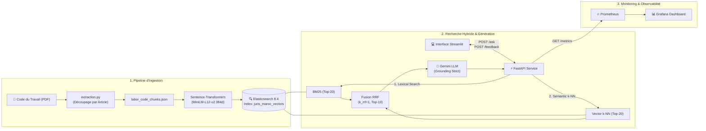
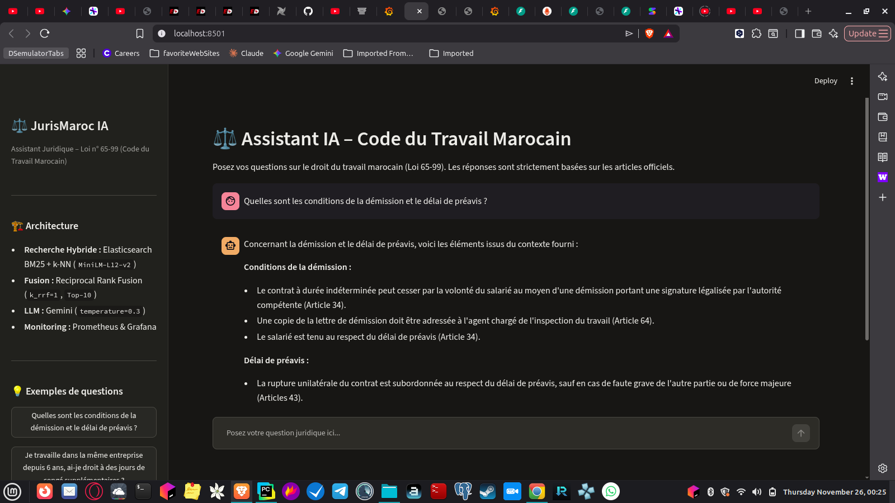
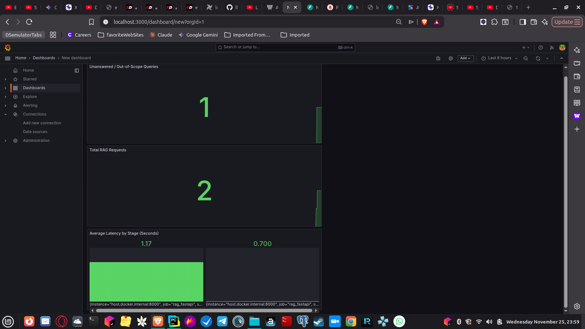

# ⚖️ JurisMaroc IA — Système RAG Hybride & Observabilité (Code du Travail Marocain)

Assistant juridique intelligent spécialisé dans le **Code du Travail Marocain (Loi n° 65-99)**.  
Ce projet implémente une architecture **RAG (Retrieval-Augmented Generation) de production** combinant recherche hybride sous **Elasticsearch (BM25 + Dense Vectors + RRF)**, évaluation quantitative (**Hit Rate, MRR, LLM-as-a-Judge**), API **FastAPI**, interface **Streamlit** et monitoring temps réel via **Prometheus & Grafana**.

---

## 🏗️ Architecture du Système



---

## ✨ Fonctionnalités Clés

- **Extraction & Découpage Sémantique Juridique :** Parsing automatisé du Bulletin Officiel (Loi 65-99) structuré par article pour préserver l'intégrité du contexte légal.
- **Recherche Hybride (BM25 + k-NN + RRF) :**
  - **BM25** avec boost sur les numéros d'articles (`article_number^2`) pour la précision terminologique.
  - **Recherche Vectorielle Dense (k-NN)** via `paraphrase-multilingual-MiniLM-L12-v2` (384 dimensions, similarité cosinus) pour capturer l'intention sémantique des questions en langage naturel.
  - **Reciprocal Rank Fusion (RRF)** personnalisée pour fusionner les classements lexicaux et vectoriels.
- **Évaluation Quantitative & Optimisation d'Hyperparamètres :** Benchmark complet sur jeu de données synthétique (Ground Truth) et validation de bout en bout par **LLM-as-a-Judge**.
- **Observabilité en Temps Réel (AIOps) :** Instrumentation **Prometheus** exposant la latence par étape (`retrieval` vs `llm`), le volume de requêtes, le taux de refus hors-contexte et le feedback utilisateur (`👍/👎`), visualisés sous **Grafana**.

---

## 📊 Évaluation & Benchmarks (`04-evaluation`)

Un jeu de données de test (**Ground Truth** de 72 questions juridiques réalistes formulées sans mentionner le numéro d'article) a été généré pour évaluer objectivement le moteur de recherche :

### 1. Performance de Recherche (Retrieval)

| Méthode de Recherche | Hit Rate @ 5 | MRR @ 5 | Gain vs. Baseline (BM25) |
| :--- | :---: | :---: | :---: |
| **1. BM25 (Lexical seul)** | 55.6% | 0.411 | *Baseline* |
| **2. Vector Search (k-NN seul)** | 66.7% | 0.500 | +11.1 pts Hit Rate |
| **3. Hybrid Search RRF (`k_rrf=60`)** | 75.0% | 0.535 | +19.4 pts Hit Rate |
| **4. Hybrid Search RRF Optimisé (`k_rrf=1`)** | **77.8%** | **0.573** | **+22.2 pts Hit Rate / +39.4% MRR** |

### 2. Évaluation End-to-End (`LLM-as-a-Judge`) & Analyse d'Erreurs
- **Pertinence des réponses (Top-5) :** **16/20 réponses jugées pertinentes** (et 1/20 partiellement pertinente) par `LLM-as-a-Judge` sur un échantillon de 20 questions. Sur les cas où l'article attendu était absent du Top-5, le modèle a répondu *« Je n'ai pas l'information »* conformément aux instructions système.
- **Analyse d'erreurs & Optimisation du Context Window :** L'inspection des requêtes échouées (ex. *Article 232* sur la majoration d'ancienneté des congés payés, classé en 7e position derrière l'Article 231) a permis d'élargir la fenêtre de récupération à **`Top-10`** avec une latence de recherche d'environ **190 ms**.
---

## 🖥️ Aperçu de l'Application & Monitoring

### Interface Utilisateur (Streamlit)


### Dashboard d'Observabilité (Grafana & Prometheus)


---

## 🚀 Installation & Démarrage Rapide

### 1. Prérequis
- **Docker & Docker Compose**
- **Python 3.12+** et [**uv**](https://github.com/astral-sh/uv)
- Une clé API Gemini (`GEMINI_API_KEY` dans un fichier `.env`)

### 2. Lancer l'infrastructure (Elasticsearch, Prometheus, Grafana)
```bash
cd LLM_RAG
docker compose up -d
```

### 3. Installer les dépendances et ingérer les données
```bash
uv sync
uv run python ingest.py
```

### 4. Démarrer l'API FastAPI et l'Interface Streamlit
```bash
# Terminal 1 : API FastAPI + Endpoint Prometheus (/metrics)
uv run --no-sync uvicorn app:app --host 0.0.0.0 --port 8000 --reload

# Terminal 2 : Interface Chat Streamlit
uv run --no-sync streamlit run ui.py
```

- **Interface Chat Streamlit :** `http://localhost:8501`
- **Documentation API (Swagger) :** `http://localhost:8000/docs`
- **Prometheus :** `http://localhost:9090`
- **Grafana :** `http://localhost:3000` (Identifiants par défaut : `admin` / `admin`)

---

## 📁 Structure du Projet

```text
├── LLM_RAG/
│   ├── extraction.py            # Extraction et découpage du PDF (Loi 65-99)
│   ├── ingest.py                # Indexation des chunks et embeddings dans Elasticsearch
│   ├── labor_code_chunks.json   # Base de connaissances structurée par article
│   ├── rag_helper.py            # Moteur RAG Hybride (BM25 + k-NN + RRF)
│   ├── app.py                   # Microservice FastAPI (/ask, /feedback, /metrics)
│   ├── ui.py                    # Interface utilisateur Streamlit
│   ├── evaluation.ipynb         # Génération Ground Truth, Hit Rate/MRR & LLM-as-a-Judge
│   ├── prometheus.yml           # Configuration du scraping Prometheus
│   └── docker-compose.yaml      # Orchestration Elasticsearch, Prometheus & Grafana
└── README.md
```